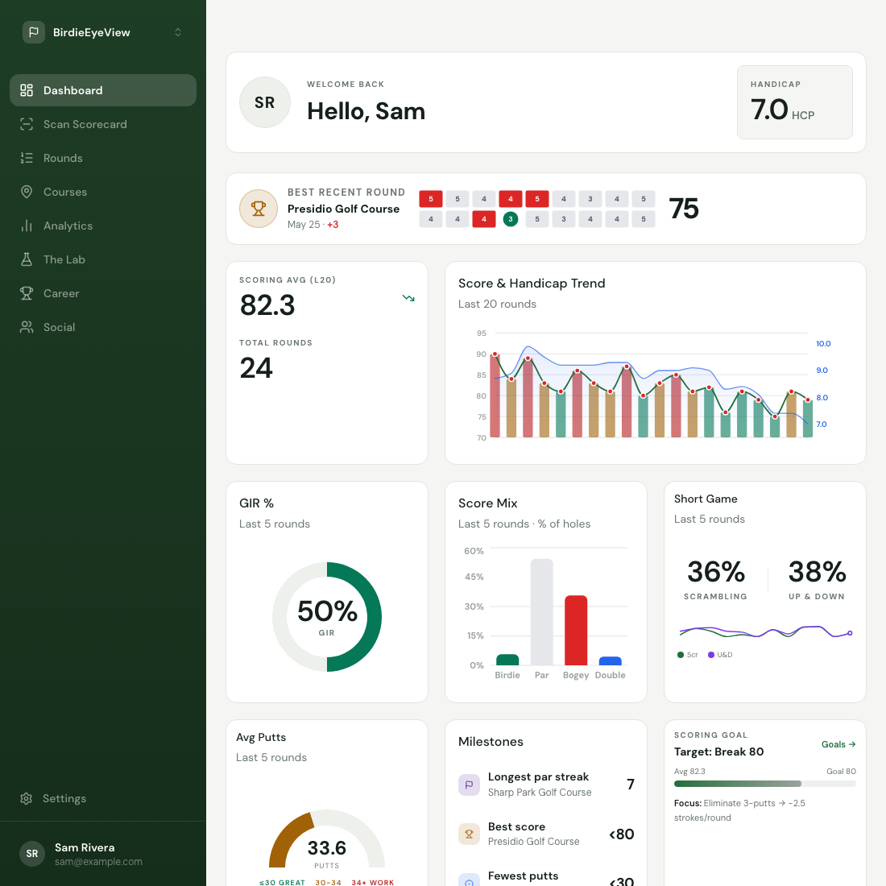
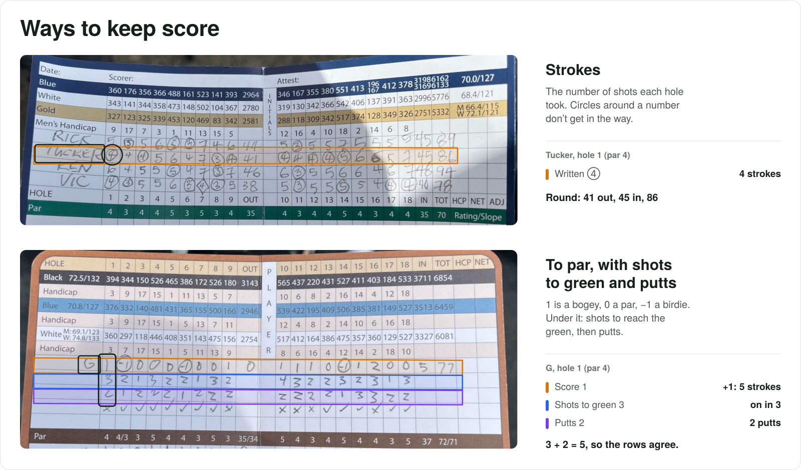
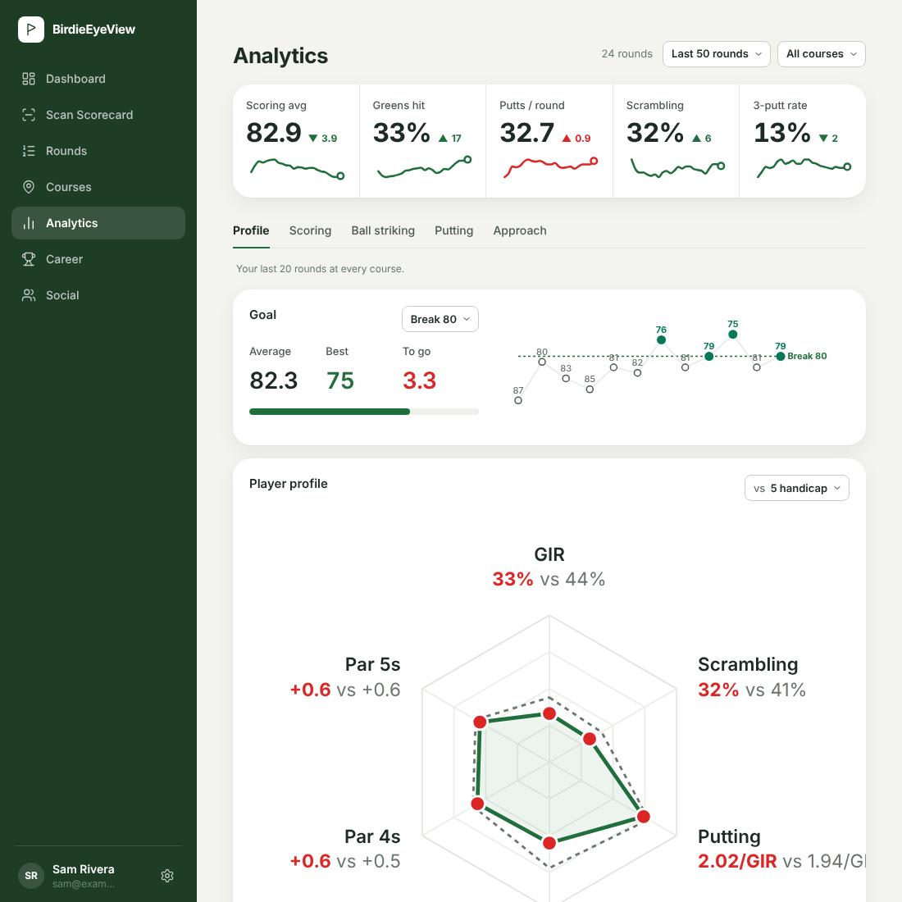
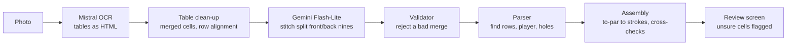

# BirdieEyeView

**[birdie-eye-view.com](https://www.birdie-eye-view.com/)**

Take a photo of your scorecard after your round. BirdieEyeView reads it, checks it, and stores it. Track your handicap, compare scores with friends, and see stats on your game.

## Ways to keep score

Golfers fill in paper cards differently, and the scanner reads the common ways. Before a scan you tell the app your name, whether scores are written as strokes or to par, and which extra rows the card has (putts, shots to green) and in what order.

## What it does

**Scan a card.** Photograph any course's scorecard, handwritten. The scanner reads hole-by-hole scores (written as strokes or to par), putts and shots to green, and picks your rows out of a card with several players on it.

**Review.** Scores the scanner is unsure of are ringed so you can take a second look. Fix anything, pick the tee box you played, and save. Try a scan out on the [site](https://www.birdie-eye-view.com/) with no account needed.

**Rounds and courses.** Compare this round to your previous ones. Each course page shows your record there, your score trend, and your average and greens per hole.

**Analytics.** Five sections: Profile, Scoring, Ball striking, Putting and Approach. Headline figures (scoring average, greens, putts, scrambling, three-putt rate) show their move over your last five rounds.

**Handicap.** A WHS handicap index from your rounds. Calculates course handicap and net score on a round if possible.

**Friends.** Add friends by code, see their handicap and last round, and put your profile side by side with theirs on the radar chart.

## How a scan works

Mistral OCR reads the card into tables. Gemini stitches a card printed in two halves back into one table, and a validator rejects any merge that doesn't line up. From there, extracting the course information and your score(s) is plain code.

Here's a real card from the eval set. Two golfers, G and T, scores written to par, with shots to green and putts under each score row:

The rows check each other. A hole's shots to green plus putts should equal its score. When they don't, the hole is ringed for review. When they settle a misread, like the circled −1 on hole 2 that OCR might sometimes read as 1, the scanner uses them to fix it.

## Evaluation

Changes to the scanner are measured against a collection of scorecards.

<picture>
  <source media="(prefers-color-scheme: dark)" srcset="docs/assets/scan-eval-dark.svg">
  
</picture>

The eval set is 22 player cases on 14 cards, each from a different course. The layouts vary: split front and back nines, to-par handwriting, several players per card, and putts and shots-to-green rows in different orders. Grading is per cell: every hole's score, putts and shots to green is compared to the answer key.

The Sonnet rows are the same eval with one change: a single Claude Sonnet 5.5 call reads the photo into the table that Mistral and Gemini produce now, and the same parsing, assembly and grading run after it. With thinking on, Sonnet gets the most cards fully right, but it is almost **three times slower** and about **seven times the cost**. With thinking off, it matches the current speed at about **four times the cost**, with slightly lower accuracy.

To run, add the `run-scan-evals` label to a PR. Each run is saved as JSON on the [`eval-results`](https://github.com/TuckerBrewer12/BirdieEyeView/tree/eval-results) branch.

## Built with

FastAPI, PostgreSQL (asyncpg) and Pydantic on the backend; React, TypeScript, Vite and Tailwind on the frontend, with D3 for the charts. Scanning uses Mistral OCR and Gemini 3.1 Flash-Lite, and course data comes from GolfCourseAPI.
