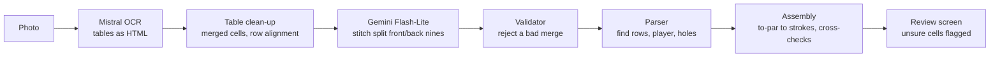
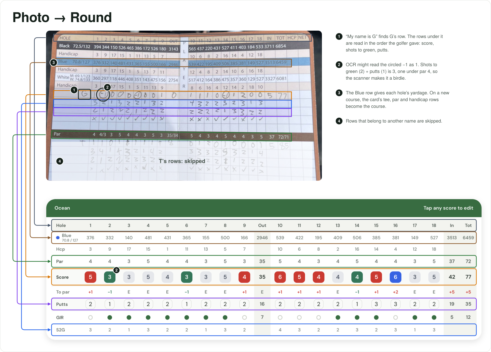
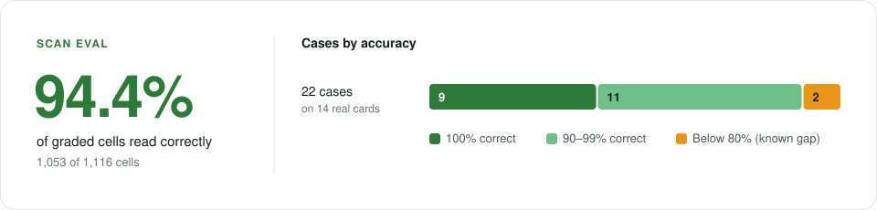

# BirdieEyeView

**[birdie-eye-view.com](https://www.birdie-eye-view.com/)**

Take a photo of a paper scorecard after your round. BirdieEyeView reads it, checks it, and turns it into a round you can edit, track and compare against every round you've played.

## Ways to keep score

Golfers fill in paper cards differently, and the scanner reads the common ways. Before a scan you tell the app your name, whether scores are written as strokes or to par, and which extra rows the card has (putts, shots to green) and in what order.

## What it does

**Scan a card.** Photograph any course's scorecard, handwritten. The scanner reads hole-by-hole scores (written as strokes or to par), putts and shots to green, and picks your rows out of a card with several players on it. OCR starts as soon as you pick the photo, while you're still filling in your name, so the result is usually ready when you hit Read card.

**Review before saving.** Scores the scanner is unsure of are ringed in amber so you know where to look. Fix anything, pick the course and tee, and save. You can also enter a round by hand, and you can try a scan from the landing page without an account.

**Rounds and courses.** Every round keeps its full scorecard, its round flow (running to-par, hole by hole) and how it compares to your last 5, last 20 and all rounds. Each course page shows your record there, your score trend, and your average and greens hole by hole, with the hardest holes ranked.

**Analytics.** Five sections: Profile, Scoring, Ball striking, Putting and Approach. Headline figures (scoring average, greens, putts, scrambling, three-putt rate) show their move over your last five rounds.

**Goals.** Pick a target like "break 80" and the app ranks where your strokes are going: three-putts, blow-up holes, your weakest yardage, a demon hole at your home course, and more. Each is sized in strokes saved.

**Handicap.** A WHS handicap index from your rounds, with a course handicap and net score on every round.

**Friends.** Add friends by code, see their handicap and last round, and put your profile side by side with theirs on the radar chart.

## How a scan works

Mistral OCR reads the card into tables. Gemini's only job is to stitch a card printed in two halves back into one table, and a validator rejects any merge that doesn't line up (for example, `line 10 has 23 columns, expected 22`). Deciding which row is par, which row is yours and what each cell means is plain code, and anything ambiguous goes back to you as a review warning instead of a guess.

Here's a real card from the eval set. Two golfers, G and T, scores written to par, with shots to green and putts under each score row:

The rows check each other. A hole's shots to green plus putts should equal its score. When they don't, the hole is ringed for review. When they settle a misread, like the circled −1 on hole 2 that OCR might read as 1, the scanner uses them to fix it.

## Evaluation

Every change to the scanner is measured against real scorecards with hand-checked answer keys.

<picture>
  <source media="(prefers-color-scheme: dark)" srcset="docs/assets/scan-eval-dark.svg">
  
</picture>

The eval set is 22 player cases on 14 real cards, each from a different course. The layouts vary: split front and back nines, to-par handwriting, several players per card, and putts and shots-to-green rows in different orders. Grading is per cell: every hole's score, putts and shots to green is compared to the answer key, with to-par handwriting converted to strokes first.

**What still fails.** Both cases below 80% are one card, Lake Chabot, which has no total-score row. Strokes have to be added up from shots to green and putts, and the scanner doesn't do that yet. Two more cases are disabled because their par row splits shots to green from putts.

**How it runs.** Adding the `run-scan-evals` label to a PR runs the suite live against Mistral and Gemini, and a bot posts the results on the PR. Every run is saved as JSON on the [`eval-results`](https://github.com/TuckerBrewer12/BirdieEyeView/tree/eval-results) branch. Separately, recorded Mistral responses for every case run through the full API in ordinary CI with no paid calls, so a parser regression fails the build before anyone pays for a live run.

## Built with

FastAPI, PostgreSQL (asyncpg) and Pydantic on the backend; React, TypeScript, Vite and Tailwind on the frontend, with D3 for the charts. Scanning uses Mistral OCR and Gemini 3.1 Flash-Lite, and course data comes from GolfCourseAPI.

Each frontend page follows MVVM on a shared component kit, with custom ESLint rules for it. PRs get screenshot tests and four review bots (MVVM, brand kit, UI tests, frontend coverage); three of them push a fix branch for what they find.

Setup, architecture and coding conventions are in [docs/](docs/README.md).
